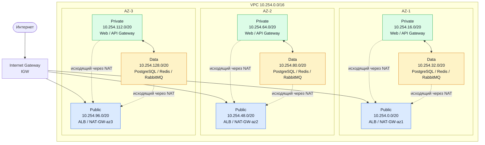

# Отчёт по лабораторной работе № 3
# Проектирование сетевой архитектуры облака (VPC, балансировщики, связность)

**Проект:** Сервис «Почини.Онлайн» (`pochini.online`)  
**Авторы:** Панин Дмитрий, Панина Анна

---


### 1. Обоснование CIDR

Для виртуального частного облака (VPC) сервиса выбран диапазон **`10.254.0.0/16`**.

**Обоснование выбора маски и диапазона:**
1. **Ёмкость сети:** Маска `/16` предоставляет 65 536 IPv4-адресов. Это стандартный размер для корпоративного облачного контура, обеспечивающий достаточный запас для разделения на 9 подсетей по трем зонам доступности (`AZ-1`, `AZ-2`, `AZ-3`) с возможностью дальнейшего масштабирования (добавление новых зон, выделенных кластеров аналитики или staging-окружений).
2. **Отсутствие пересечений:** Диапазон `10.254.0.0/16` гарантированно не пересекается с зафиксированными внутренними подсетями инфраструктуры компании:
   - `10.10.0.0/16` — локальная on-premise production-сеть;
   - `10.42.0.0/16` — Kubernetes Pod Network;
   - `10.43.0.0/16` — Kubernetes Service Network;
   - `10.66.0.0/24` и `10.67.0.0/24` — тестовый и рабочий контуры VPN (WireGuard);
   - `10.253.0.0/16` — stage/dev-контур и Docker-сети.

---

### 2. Таблица подсетей

Сеть разделена на 3 зоны доступности, в каждой из которых выделено по 3 уровня подсетей (Public, Private, Data) с префиксом `/20` (по 4096 адресов на подсеть):

| Зона | Подсеть | CIDR | Тип | Маршрут по умолчанию (`0.0.0.0/0`) | Назначение |
| :--- | :--- | :--- | :--- | :--- | :--- |
| **AZ-1** | `public-az1` | `10.254.0.0/20` | public | `IGW` | Внешний ALB, NAT Gateway AZ-1 |
| **AZ-1** | `private-az1` | `10.254.16.0/20` | private | `NAT-GW-az1` | Web-клиент, API Gateway, микросервисы |
| **AZ-1** | `data-az1` | `10.254.32.0/20` | data | `NAT-GW-az1` / `VPC Endpoint` | PostgreSQL, Redis, RabbitMQ, MinIO |
| **AZ-2** | `public-az2` | `10.254.48.0/20` | public | `IGW` | Внешний ALB, NAT Gateway AZ-2 |
| **AZ-2** | `private-az2` | `10.254.64.0/20` | private | `NAT-GW-az2` | Web-клиент, API Gateway, микросервисы |
| **AZ-2** | `data-az2` | `10.254.80.0/20` | data | `NAT-GW-az2` / `VPC Endpoint` | PostgreSQL, Redis, RabbitMQ, MinIO |
| **AZ-3** | `public-az3` | `10.254.96.0/20` | public | `IGW` | Внешний ALB, NAT Gateway AZ-3 |
| **AZ-3** | `private-az3` | `10.254.112.0/20` | private | `NAT-GW-az3` | Web-клиент, API Gateway, микросервисы |
| **AZ-3** | `data-az3` | `10.254.128.0/20` | data | `NAT-GW-az3` / `VPC Endpoint` | PostgreSQL, Redis, RabbitMQ, MinIO |

**Особенности маршрутизации:**
- Во всех таблицах присутствует системный локальный маршрут `10.254.0.0/16 → local`, обеспечивающий прямое взаимодействие между подсетями VPC.
- Публичные подсети имеют прямой маршрут `0.0.0.0/0 → IGW` и принимают входящий HTTPS-трафик на балансировщик. Сервисы бизнес-логики и базы данных в них не размещаются.
- Приватные подсети не имеют входящих маршрутов из интернета: маршрут по умолчанию направлен на локальный `NAT Gateway` своей зоны доступности (только исходящие соединения).
- Data-подсети изолированы от прямого интернета: обновления и бэкапы наружу идут через локальный `NAT Gateway`, а доступ к облачным сервисам (S3, Container Registry, Secrets Manager) маршрутизируется через приватные `VPC Endpoints` без выхода в публичный интернет.

---

### 3. Схема сети



---

### 4. Балансировщики

Для сервиса спроектирована схема с **Application Load Balancer (ALB)**, развёрнутым в публичных подсетях в трёх зонах доступности (`AZ-1`, `AZ-2`, `AZ-3`), и внутренним ALB для изолированного контура управления.

#### Сводная таблица балансировщиков

| Сервис | Тип балансировщика | Уровень | Правило маршрутизации | Алгоритм | Health check |
| :--- | :--- | :--- | :--- | :--- | :--- |
| **Веб-клиент** (статика/SPA) | Public ALB | **L7** | Путь по умолчанию `/*` | Round Robin | `GET /` → HTTP `200` (порт 3000) |
| **API Gateway** (бизнес-логика) | Public ALB | **L7** | Пути `/api/*`, `/orders/*` | Least Connections | `GET /api-gateway/ready` → HTTP `200` (порт 8000) |
| **Notifier callback** | Public ALB | **L7** | Путь `/notifier/callbacks/*` | Round Robin | `GET /notifier/health` → HTTP `200` (порт 8000) |
| **Backoffice / Admin** | Internal ALB | **L7** | Доступ только из VPN: `/` → Backoffice, `/api/*` → Admin BFF | RR (UI) / LC (API) | `GET /health` → HTTP `200` (порты 8080/8000) |

#### Обоснование выбора L7 (ALB)
1. **Маршрутизация по путям (Path-based routing):** Входящий HTTPS-трафик разделяется на уровне одного балансировщика и одного доменного имени:
   - Запросы к бизнес-логике (`/api/*` и `/orders/*`) маршрутизируются в target group API Gateway.
   - Остальные запросы (`/*`) направляются на веб-фронтенд для отдачи статических файлов.
   Для анализа заголовков HTTP (`Host`, `URL path`) необходима терминация TLS и разбор протокола прикладного уровня, что возможно только на **L7**.
2. **WebSocket и долгоживущие соединения:** ALB нативно поддерживает апгрейд HTTP-соединений до WebSocket (`/api/v1/ws`) для чатов и уведомлений.

#### Обоснование алгоритмов балансировки и Health Checks
- **Round Robin для веб-фронтенда и callbacks:** Реплики фронтенда stateless и взаимозаменяемы, запросы на отдачу статики однородны по вычислительной сложности.
- **Least Connections для API:** Длительность API-запросов и WebSocket-сессий сильно варьируется (создание заказа с валидацией vs получение профиля). Передача нового запроса наименее нагруженному инстансу предотвращает деградацию сервиса при неравномерной нагрузке.
- **Health Checks:** Проверка готовности сервиса (`/ready` с кодом `200`). При трех неудачных проверках инстанс исключается из пула, а механизм **Connection Draining (Deregistration Delay)** дает активным сессиям и WebSocket-соединениям завершиться корректно.

#### Балансировка базы данных (L4 NLB)
Для репликации базы данных (сырой TCP-трафик, порт 5432) теоретически применим **Network Load Balancer (NLB, L4)**. Однако чистый L4 NLB не проверяет роль узла (Master vs Read-Replica), а только доступность порта. Поэтому для кластера PostgreSQL в проекте используется прикладная балансировка на уровне пулера соединений (PgBouncer/HAProxy/Patroni), а отдельный NLB для БД не настраивается.

---

### 5. Связность и резервирование

#### Internet Gateway (IGW)
К VPC подключен единый отказоустойчивый шлюз **Internet Gateway (IGW)**, управляемый провайдером. Во всех трёх публичных подсетях настроен маршрут:
```text
10.254.0.0/16 → local
0.0.0.0/0    → IGW
```

#### NAT Gateway и защита от SPOF (Single Point of Failure)
Для исключения единой точки отказа (SPOF) развернуто **три независимых NAT Gateway** — строго по одному в публичной подсети каждой зоны доступности (`NAT-GW-az1`, `NAT-GW-az2`, `NAT-GW-az3`):
- Приватные и data-подсети используют шлюз **своей зоны**:
  - `private-az1` и `data-az1` → `NAT-GW-az1`
  - `private-az2` и `data-az2` → `NAT-GW-az2`
  - `private-az3` и `data-az3` → `NAT-GW-az3`
- **Зачем это нужно:** Если разместить один общий NAT Gateway на всю VPC (например, только в AZ-1), то при сбое дата-центра AZ-1 приватные подсети из AZ-2 и AZ-3 полностью потеряют исходящий доступ в интернет. Модель «1 NAT на зону» гарантирует зональную изоляцию сбоев.
- **Аварийное переключение (Failover):** В случае локальной деградации NAT Gateway в AZ-1 маршрут по умолчанию в таблице маршрутизации может быть оперативно переключен скриптом автоматизации/Route Controller на `NAT-GW-az2`.

#### Связность с On-Premise инфраструктурой и резервирование каналов
Для связи облачной VPC с корпоративным дата-центром компании организована гибридная схема с резервированием:

| Канал | Технология | Назначение | Оборудование |
| :--- | :--- | :--- | :--- |
| **Основной канал** | AWS Direct Connect (или аналог у провайдера) | Выделенный физический L2/L3 канал с низкой задержкой и гарантированной полосой пропускания | Маршрутизатор R1 в дата-центре |
| **Резервный канал** | Site-to-Site IPsec VPN | Шифрованный туннель поверх публичного интернета через независимого провайдера связи | Маршрутизатор R2 в дата-центре |

**Механизм резервирования:**
- Динамическая маршрутизация настраивается по протоколу **BGP (Border Gateway Protocol)**.
- Основной маршрут через Direct Connect имеет меньший вес (более высокий Local Preference / более короткий AS Path).
- При обрыве физического линка или отказе маршрутизатора R1 сессия BGP падает (через BFD/keepalive таймеры), и трафик мгновенно и бесшовно переключается на резервный Site-to-Site VPN через R2.

---

### 6. Безопасность и журналирование

#### Security Groups (Stateful-файрволы)
Так как Security Groups работают в режиме **stateful** (если входящий пакет разрешен, ответный исходящий пакет пропускается автоматически независимо от исходящих правил, и наоборот), для каждого уровня сервиса настроены строгие минимально необходимые правила:

| Security Group | Входящие правила (Ingress) | Исходящие правила (Egress) | Назначение |
| :--- | :--- | :--- | :--- |
| **`sg-public-alb`** | • TCP `443` от `0.0.0.0/0`<br/>• TCP `80` от `0.0.0.0/0` (только редирект на HTTPS) | • TCP `3000` к `sg-web`<br/>• TCP `8000` к `sg-api`<br/>• TCP `8000` к `sg-notifier` | Публичный балансировщик нагрузки |
| **`sg-web`** | • TCP `3000` **только** от `sg-public-alb` | • TCP `443` к внешним ресурсам через NAT (при необходимости) | Веб-клиент (статика / SPA) |
| **`sg-api`** | • TCP `8000` **только** от `sg-public-alb` | • TCP `5432` к `sg-db`<br/>• TCP `6379` к `sg-redis`<br/>• TCP `5672` к `sg-rabbitmq`<br/>• TCP `443` через NAT к внешним API | API Gateway и бизнес-логика |
| **`sg-internal-alb`** | • TCP `443` **только** от `10.67.0.0/24` (WireGuard VPN) | • TCP `8080` к `sg-backoffice`<br/>• TCP `8000` к `sg-admin` | Внутренний балансировщик админки |
| **`sg-db`** | • TCP `5432` **строго только** от `sg-api`<br/>• TCP `5432` от `sg-db` (репликация между AZ) | • Запрещен произвольный исходящий трафик (только ответы и авторизованный экспорт бэкапов) | Кластер PostgreSQL |
| **`sg-redis` / `sg-rabbitmq`** | • TCP `6379` / `5672` **только** от доверенных `sg-api` | • Только локальные ответы сервисам | Кэш и очередь сообщений |

> **Контрольная точка:** База данных размещена в `data`-подсетях, не имеет белых IP-адресов, изолирована от интернета маршрутами и в правилах `sg-db` принимает входящие подключения по порту 5432 **исключительно от security group `sg-api`**.

#### NAT Gateway изоляция
- NAT Gateway транслирует исходящие приватные IP-адреса в белый публичный Elastic IP.
- Он **не принимает** входящие соединения, инициированные из внешнего интернета. Ответные пакеты пропускаются только для сессий, созданных изнутри подсетей.

#### VPC Flow Logs
VPC Flow Logs включены на уровне всей VPC для фиксации сетевых событий по всем сетевым интерфейсам (ENI):
- **Режимы фиксации:** Логируются как успешные подключения (`ACCEPT`), так и заблокированные файрволом попытки (`REJECT`).
- **Куда отправляются:** В CloudWatch Logs / S3 с политикой ротации и ограниченным доступом.
- **Что содержат логи:** IP источника/назначения, порты, протокол, интерфейс (ENI), число пакетов/байт, интервал времени, статус (`ACCEPT`/`REJECT`).
- **Что позволяют обнаружить:**
  1. Сканирование портов и попытки несанкционированного доступа снаружи или между подсетями (всплеск событий `REJECT`).
  2. Ошибки в правилах Security Groups / маршрутизации (сервис не может достучаться до БД или NAT GW).
  3. Аномальную сетевую активность и попытки эксфильтрации данных при компрометации инстанса (неожиданные исходящие соединения с неизвестными IP).

---

### Выводы

В ходе выполнения лабораторной работы спроектирована отказоустойчивая сетевая архитектура для платформы «Почини.Онлайн» (`pochini.online`):
1. **Зональное резервирование:** Разделение VPC на три зоны доступности (`AZ-1`, `AZ-2`, `AZ-3`) и развертывание независимых NAT Gateway в каждой зоне исключает единую точку отказа (SPOF) при сбое целого дата-центра.
2. **Многоуровневая эшелонированная защита (Defense in Depth):** Разделение на публичный, приватный и изолированный data-уровни подсетей в сочетании со stateful Security Groups гарантирует, что базы данных и очереди сообщений полностью отрезаны от прямого входящего трафика из интернета и доступны только с авторизованных узлов API.
3. **Оптимальный выбор балансировки:** Использование Application Load Balancer (ALB, L7) позволило реализовать маршрутизацию по путям (`/api/*`, `/orders/*` на бэкенд, остальное — на веб-фронтенд) на базе одного доменного имени и единой точки входа с поддержкой WebSocket и health checks с connection draining.
4. **Гибридная связность:** Схема подключения on-premise дата-центра с основным каналом через Direct Connect и резервным Site-to-Site VPN под управлением динамической маршрутизации BGP обеспечивает непрерывность бизнес-процессов при авариях на физических каналах связи.
---

## Контрольные вопросы

### 1. Чем VxLAN отличается от VLAN? Какие ограничения VLAN решает VxLAN?
- **Размер пространства идентификаторов:** Классический VLAN использует 12-битный тег `VLAN ID` в заголовке Ethernet (802.1Q), что ограничивает количество изолированных сегментов числом **4096**. VxLAN использует 24-битный идентификатор сети **VNI**, расширяя количество изолированных виртуальных сетей до **16 миллионов**.
- **Сетевой уровень и инкапсуляция (Overlay):** VLAN работает строго в пределах одного широковещательного домена L2 и ограничен границами физических коммутаторов и Spanning Tree Protocol. VxLAN инкапсулирует L2 Ethernet-фреймы в стандартные **L3 UDP-пакеты** (порт 4789). Это позволяет строить виртуальные L2-сети поверх масштабируемых маршрутизируемых IP-фабрик (L3 Underlay), устраняя проблемы петель STP и обеспечивая передачу трафика между разными стойками и дата-центрами.

### 2. ALB или NLB для gRPC и WebSocket? Аргументируйте через уровень работы балансировщика.
- **WebSocket:** Однозначно **ALB (L7)**. Установление соединения WebSocket начинается со стандартного HTTP-запроса рукопожатия с заголовком `Upgrade: websocket`. ALB анализирует HTTP-заголовки, корректно выполняет апгрейд протокола и поддерживает долгоживущее двунаправленное соединение, одновременно позволяя применять маршрутизацию по URL-путям (например, направлять `/api/v1/ws` в чат-сервис, а обычный HTTP-трафик — в другие микросервисы).
- **gRPC:** Рекомендуется **ALB (L7)**, поскольку gRPC работает поверх протокола **HTTP/2**. Балансировщик L7 понимает структуру HTTP/2 фреймов и мультиплексирование, что позволяет балансировать **каждый отдельный RPC-вызов** по разным бэкендам внутри одного TCP-соединения. Балансировщик L4 (NLB) балансирует лишь на уровне TCP-соединений: в результате все gRPC-вызовы из одного постоянного TCP-канала пойдут на один и тот же сервер, создавая перекос нагрузки.

### 3. Что будет с CDN, если не выставить Cache-Control? Почему важно настроить TTL для API?
- **Поведение без Cache-Control:** Если сервер не отдает заголовки управления кэшированием (`Cache-Control: max-age=...` / `no-cache` / `private`), пограничные узлы CDN применяют эвристическое кэширование (heuristic caching) по своим умолчаниям либо вовсе отказываются кэшировать ответ. Это может привести либо к избыточной паразитной нагрузке на Origin-сервер, либо к случайному кэшированию приватных/динамических данных других пользователей.
- **TTL для API:** Настройка небольшого TTL от нескольких секунд до пары минут для часто запрашиваемых read-only эндпоинтов  многократно срезает пиковую нагрузку на базу данных и бэкенд при наплыве пользователей и сокращает задержку за счет отдачи данных с ближайших к пользователю Edge-локаций. Для мутирующих и чувствительных API выставляется `Cache-Control: no-store, private`.

### 4. Сколько NAT Gateway нужно в production на 3 зоны доступности и почему?
В production необходимо разворачивать **строго 3 NAT Gateway** — по одному шлюзу в публичной подсети каждой зоны доступности.
- **Исключение Single Point of Failure:** NAT Gateway является зональным ресурсом. Если создать 1 общий NAT Gateway в AZ-1, то при физической аварии дата-центра AZ-1 приватные и data-подсети в AZ-2 и AZ-3 потеряют весь исходящий доступ в интернет , несмотря на то, что сами эти зоны продолжают функционировать.
- **Сокращение Cross-AZ трафика:** Трафик внутри одной зоны не покидает пределы AZ, что снижает задержку и исключает лишние затраты на оплату междетацентрового трафика.

### 5. Чем Security Group отличается от Network ACL (stateful vs stateless)?
- **Stateful (Security Group):** Отслеживает состояние соединения в специальной таблице трансляций. Если входящий запрос разрешен правилом Ingress, ответный исходящий пакет автоматически пропускается файрволом обратно клиенту независимо от правил Egress (и наоборот). Применяется на уровне виртуального сетевого интерфейса (ENI) конкретного инстанса.
- **Stateless (Network ACL):** Не сохраняет информацию о состоянии сессий. Каждый отдельный пакет оценивается изолированно. Чтобы сетевое соединение состоялось, администратор обязан явно разрешить входящий трафик на нужный порт (например, TCP 443) в Inbound Rules и явно разрешить исходящий ответный трафик на диапазон эфемерных портов клиента (TCP 1024–65535) в Outbound Rules. Применяется на уровне границы подсети целиком.

### 6. Почему нельзя держать базу данных в публичной подсети?
1. **Прямая поверхность атаки:** Публичная подсеть имеет маршрут `0.0.0.0/0 → IGW` и выделяет публичные IP-адреса. Любая ошибка в конфигурации файрвола, 0-day уязвимость в СУБД, перебор паролей (brute force) или утечка сервисных учетных данных приведет к прямому несанкционированному доступу к данным из интернета в обход систем авторизации бэкенда.
2. **Принцип наименьших привилегий и сетевая сегментация:** База данных должна принимать соединения **исключительно** от сервисов бизнес-логики (API), находящихся в доверенном приватном контуре. Размещение в изолированной `data`-подсети без прямого доступа из интернета гарантирует, что даже при компрометации публичного балансировщика или фронтенда база данных останется физически недосягаема снаружи.

### 7. Зачем нужны VPC Flow Logs и что они позволяют обнаружить?
VPC Flow Logs — это инструмент аудита и телеметрии, фиксирующий метаданные сетевого IP-трафика на сетевых интерфейсах VPC (источник, назначение, порты, протокол, число пакетов/байт, действие `ACCEPT`/`REJECT`).
Они позволяют обнаружить:
1. **Сетевые атаки и аномалии:** Попытки сканирования портов, перебора паролей или неавторизованного горизонтального перемещения между подсетями (всплеск статусов `REJECT`).
2. **Компрометацию хостов и утечку данных:** Неожиданные исходящие сессии на подозрительные публичные IP-адреса или нестандартные порты (ботнеты, C&C серверы, криптомайнеры).
3. **Ошибки в сетевой архитектуре:** Неверные правила в Security Groups или Network ACL, из-за которых легитимный трафик между сервисами отбрасывается, либо проблемы с маршрутизацией к NAT Gateway / VPC Endpoint.


