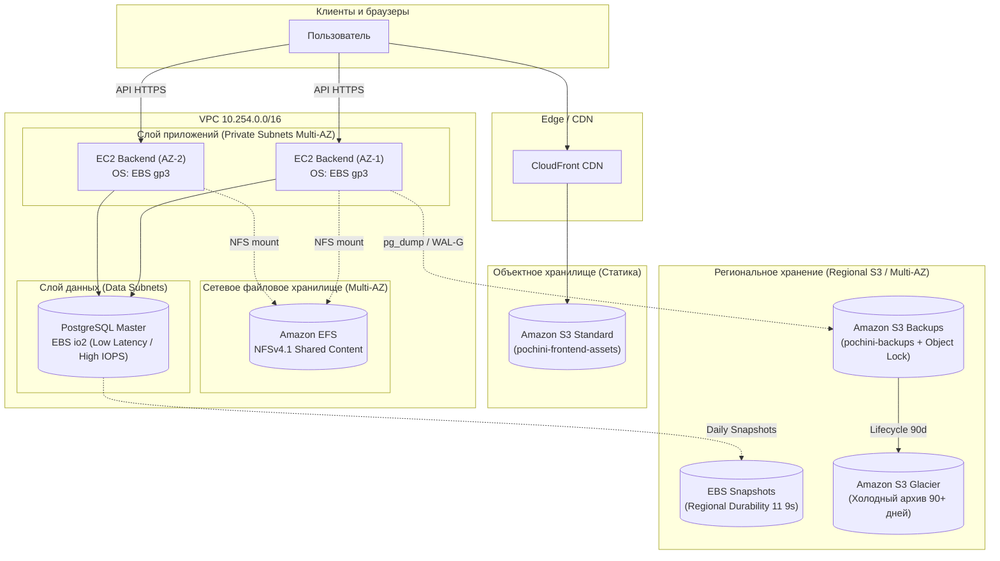

# Отчёт по лабораторной работе № 5
# Хранилища данных в облаке (Block, File, Object: выбор и применение)

**Проект:** Сервис «Почини.Онлайн» (`pochini.online`)  
**Авторы:** Панин Дмитрий, Панина Анна

---

## 1. Сравнительный анализ типов хранилищ

### 1.1. Сравнительная характеристика сервисов AWS (EBS, EFS, S3)

| Параметр | EBS (Block Storage) | EFS (File Storage) | S3 (Object Storage) |
| :--- | :--- | :--- | :--- |
| **Уровень абстракции** | Низкий (сырые блоки данных) | Средний (файлы, каталоги, POSIX) | Высокий (объекты: данные + метаданные) |
| **Единица данных** | Фиксированный блок | Файл / Директория | Объект (Key, Value, Metadata) |
| **Количество клиентов** | 1 EC2-инстанс (стандартно) | Множество EC2-инстансов (NFS) | Неограниченно (через HTTP/HTTPS API) |
| **Сетевой протокол** | Проприетарный шинный (NVMe / SCSI over fabric) | NFSv4.0 / NFSv4.1 | HTTPS / REST API (S3 API) |
| **Масштабирование** | Ручное (изменение размера тома) | Автоматическое (эластичное расширение) | Практически безграничное (петабайты и экзабайты) |
| **Стоимость за ГБ** | Высокая | Средняя / Выше среднего | Низкая (с градацией по классам) |
| **Задержка (Latency)** | Минимальная (< 1–2 мс) | Средняя (~5–15 мс) | Высокая (десятки/сотни мс по HTTP) |
| **Отказоустойчивость** | Репликация внутри одной AZ; снапшоты в S3 (Region) | Избыточность в 3+ зонах доступности (Multi-AZ) | 99.999999999% (11 девяток), репликация между AZ |

### 1.2. Закономерность изменения производительности и стоимости

Переход от **Block** к **Object** отражает фундаментальный компромисс облачной инфраструктуры:
- **Производительность и задержка:** падают. EBS подключается напрямую к гипервизору с минимальным оверхедом и даёт микросекундные задержки, необходимые базам данных. S3 работает поверх протокола HTTP/HTTPS, что вносит сетевой оверхед и исключает произвольную модификацию байтов внутри объекта.
- **Стоимость и масштабируемость:** улучшаются на порядки. EBS требует резервирования емкости и оплаты всего выделенного объема. S3 тарифицируется исключительно за фактически занятый объем, поддерживает автоматический тиринг и позволяет хранить петабайты данных без деградации масштабируемости.
- **Файловые хранилища (EFS):** занимают промежуточное положение, обеспечивая сетевую разделяемость файловой системы для одновременного чтения/записи группой серверов, жертвуя задержкой относительно EBS и дешевизной относительно S3.

> **Главное правило:** *«Блок — для скорости, Файл — для совместного доступа, Объект — для масштаба и экономии».*

---

## 2. Распределение сервисов pochini.online по типам хранилищ

| Сервис / Компонент | Тип хранилища | Сервис AWS | Класс / Тип | Обоснование выбора |
| :--- | :--- | :--- | :--- | :--- |
| **Веб-фронтенд (статика)** | Object Storage | Amazon S3 | S3 Standard + CloudFront CDN | Раздача статики (JS, CSS, изображения) не требует файловой системы. S3 интегрируется с CDN, выдерживает любые пиковые нагрузки и минимизирует стоимость трафика. |
| **API-бэкенд (виртуальные машины)** | Block Storage | Amazon EBS | gp3 (General Purpose SSD) | Для системных дисков ОС виртуальных машин необходима минимальная задержка загрузки и выполнения бинарников, поддержка файловых систем ext4/xfs и низкая стоимость при базовых IOPS. |
| **База данных (PostgreSQL)** | Block Storage | Amazon EBS | io2 / gp3 | СУБД критичны предсказуемая задержка дисковых операций (low latency), гарантированные IOPS для транзакционного лога (WAL) и поддержка моментальных снапшотов без блокировок. |
| **Общий каталог (Shared media/configs)** | File Storage | Amazon EFS | General Purpose (Multi-AZ) | Несколько инстансов бэкенда должны одновременно читать и писать общие пользовательские файлы без конфликтов через стандартный протокол NFSv4. |
| **Бэкапы и долгосрочный архив** | Object Storage | Amazon S3 | S3 Standard-IA / Glacier Flexible Archive | Резервные копии и дампы БД на терабайты/петабайты требуют максимальной надежности (11 девяток), минимальной цены за ГБ и автоматического перевода в холодные архивы. |

---

## 3. Таблица аналогов у облачных провайдеров

| Тип хранилища | AWS | Yandex Cloud | VK Cloud | Microsoft Azure | Google Cloud (GCP) |
| :--- | :--- | :--- | :--- | :--- | :--- |
| **Block Storage** | Amazon EBS | Compute Disks | Cloud Block Storage (Volumes) | Azure Managed Disks | Persistent Disk |
| **File Storage** | Amazon EFS | Cloud File Storage | Cloud File Storage (NFS) | Azure Files | Filestore |
| **Object Storage** | Amazon S3 | Yandex Object Storage | Cloud Storage | Azure Blob Storage | Cloud Storage (GCS) |

---

## 4. Архитектурные решения по сервисам хранения (AWS)

### 4.1. Хранилище базы данных (EBS): выбор типа тома и обоснование

Для реляционной СУБД (PostgreSQL) сервиса `pochini.online` принята двухуровневая стратегия выбора блочных томов:

1. **Базовый production-выбор — `EBS gp3`:**
   - **Почему:** в поколении `gp3` базовые параметры производительности (3 000 IOPS и 125 МБ/с пропускной способности) предоставляются бесплатно и не зависят от выделенного дискового пространства (в отличие от устаревшего `gp2`, где IOPS зависели от объема тома).
   - Этого достаточно для большинства типовых нагрузок API сервиса `pochini.online`. При росте нагрузки можно независимо докупать IOPS (до 16 000) и Throughput (до 1 000 МБ/с) без остановки виртуальной машины и без переплаты за лишние гигабайты диска.
2. **Критерии перехода на `EBS io2` (Provisioned IOPS):**
   - Переход на `io2` необходим при наступлении высокой транзакционной нагрузки, когда приложению требуются гарантированные IOPS свыше 16 000 и критически важна ультранизкая задержка (< 1 мс) с вероятностью соблюдения SLA 99.9% времени.
   - Также `io2` обеспечивает повышенную надежность (durability 99.999% против 99.8–99.9% у `gp3`), что актуально для финансово критичных транзакций.
3. **Почему магнитные диски (`st1` / `sc1`) не подходят для БД:**
   - Диски `st1` (Throughput Optimized HDD) и `sc1` (Cold HDD) оптимизированы под большие последовательные операции чтения/записи (Big Data, потоковая обработка логов, data warehousing).
   - Рабочая нагрузка СУБД носит случайный (random I/O) характер блоками по 4–8 КБ. Механические головки HDD физически не способны обеспечить более 200–500 IOPS и дают задержки порядка сотен миллисекунд (latency spikes), что немедленно приводит к блокировкам транзакций и деградации базы.

### 4.2. Стратегия аварийного восстановления: снапшоты EBS

- **Уровень хранения снапшота:** в отличие от самого тома EBS, который жестко привязан к конкретной зоне доступности (`Availability Zone`, AZ), **снапшоты EBS автоматически сохраняются в Amazon S3 на уровне всего региона**.
- **Преимущество для Disaster Recovery:** если дата-центр конкретной зоны полностью выходит из строя, том EBS в этой зоне становится недоступен. Однако, благодаря региональному хранению снапшота в S3, инженер или автоматика Auto Scaling / Terraform может мгновенно развернуть новый EBS-том из последнего снапшота в любой уцелевшей зоне (`AZ-2` или `AZ-3`) и подключить его к резервной виртуальной машине.
- **Инкрементальность:** снапшоты сохраняют только измененные с момента прошлого бэкапа блоки, что экономит трафик и стоимость хранения.

### 4.3. Веб-фронтенд: статика и интеграция с CDN

- Статические ассеты (JS-бандлы, CSS, шрифты, аватары, фото неисправностей) размещаются в бакете **Amazon S3 Standard**.
- Прямой публичный доступ к бакету закрыт через *Block Public Access*, а запросы пользователей обслуживаются через **CloudFront CDN** с использованием механизма *Origin Access Control (OAC)*.
- Это обеспечивает кеширование контента на пограничных серверах, защиту от DDoS, разгрузку серверов приложений и минимальное время отклика для клиентов.

### 4.4. Общий каталог: EFS и одновременный сетевой доступ

- Для файлов общего пользования (отчеты генерации счетов, временные медиафайлы при обработке заказов) развернута файловая система **Amazon EFS** (General Purpose, Multi-AZ).
- **Схема подключения:** в каждой из трех подсетей (`private-az1`, `private-az2`, `private-az3`) создается сетевой интерфейс точки монтирования (*Mount Target*).
- Виртуальные машины бэкенда одновременно монтируют этот ресурс по протоколу **NFSv4.1**. EFS берет на себя распределенную синхронизацию, блокировки файлов (file locking) и автоматическое масштабирование емкости без необходимости заранее резервировать дисковое пространство.

---

## 5. Классы хранения Amazon S3 и жизненный цикл данных

### 5.1. Сравнительная таблица классов хранения S3

| Класс хранения | Назначение | Доступность и задержка | Стоимость хранения (относительно) | Минимальный срок хранения |
| :--- | :--- | :--- | :--- | :--- |
| **S3 Standard** | «Горячие» данные, частый доступ, статика веб-приложения | Мгновенный (мс), SLA 99.99% | Базовая (~$0.023 / ГБ) | Отсутствует |
| **S3 Intelligent-Tiering** | Данные с неизвестным или меняющимся паттерном обращений | Мгновенный (мс), автоматическое движение | Базовая + небольшая плата за мониторинг | Отсутствует (30 дней для автоуровней) |
| **S3 Standard-IA** | Инфредко запрашиваемые данные (бэкапы старше 30 дней) | Мгновенный (мс), плата за объем извлечения | Дешевле на ~40–50% (~$0.0125 / ГБ) | 30 дней |
| **S3 Glacier Flexible Archive** | Холодные архивы, квартальные копии | От 1–5 минут (Expedited) до 3–5 часов (Standard) | Дешевле на ~80% (~$0.0036 / ГБ) | 90 дней |
| **S3 Glacier Deep Archive** | Долгосрочные многолетние архивы (compliance, аудит) | До 12 часов (Standard / Bulk) | Самая низкая в облаке (~$0.00099 / ГБ) | 180 дней |

### 5.2. Правила жизненного цикла (S3 Lifecycle Policy) для бэкапов

Для бакета резервных копий базы данных и логов (`pochini-backups`) настроена следующая политика жизненного цикла:

```
[0-й день]           [30-й день]              [90-й день]                 [365-й день]
Создание бэкапа ---> Перенос в Standard-IA -> Перенос в Glacier Flexible -> Удаление (Expiration)
(S3 Standard)        (Infrequent Access)      (Холодный архив)            или Deep Archive
```

**Обоснование таймингов и экономическая целесообразность:**
1. **0–30 дней в `S3 Standard`:**  
   Свежие резервные копии и дампы базы данных наиболее востребованы в первые недели при расследовании недавних сбоев, тестировании обновлений и аварийных откатах. В Standard доступ мгновенный и отсутствует комиссия за чтение.
2. **Переход в `S3 Standard-IA` на 30-й день:**  
   В AWS S3 минимальный расчетный период хранения для класса `Standard-IA` составляет **30 дней**. Если перевести объект раньше (например, через 3–7 дней), провайдер всё равно спишет плату за 30 дней хранения, что нивелирует экономию. На 30-й день обращение к бэкапу становится маловероятным, а стоимость хранения сразу снижается практически в 2 раза.
3. **Переход в `S3 Glacier Flexible` на 90-й день:**  
   Бэкапы трехмесячной давности нужны только при комплексном аудите или катастрофических сбоях. Минимальный биллинговый период Glacier — 90 дней. Переход обеспечивает удешевление хранения более чем в 6 раз относительно Standard.
4. **Удаление или Deep Archive на 365-й день:**  
   Ежедневные инкрементальные дампы удаляются по истечении года, а ежегодные регламентные срезы переводятся в `Glacier Deep Archive` (стоимость менее \$1 за 1 ТБ в месяц).

### 5.3. Защита данных: версионирование и S3 Object Lock

Для бакета с бэкапами активированы механизмы защиты:
- **Версионирование бакета (Bucket Versioning):**  
  Сохраняет полную историю изменений каждого объекта. При попытке перезаписать существующий файл с дампом (`db_dump_latest.sql.gz`) создается новая версия с уникальным `Version ID`, а старая остается в неизменном виде. При случайном удалении файла S3 не уничтожает данные, а лишь ставит маркер удаления (*Delete Marker*), который легко откатить.
- **S3 Object Lock (WORM — Write Once, Read Many):**  
  Фиксирует объект в неизменяемом состоянии на заданный срок (Compliance Mode или Governance Mode). Ни один пользователь, включая администратора и скомпрометированные API-ключи, не может удалить или перезаписать заблокированный бэкап. Это главная линия защиты от вирусов-вымогателей и человеческого фактора.

### 5.4. Оптимизация выборки: S3 Select и Glacier Select

- **Принцип работы:** выполнение SQL-выражений (например, `SELECT * FROM s3object s WHERE s.status_code = '500'`) непосредственно на серверах хранения S3 внутри несжатых или gzip/bzip2 архивов форматов CSV, JSON или Apache Parquet.
- **Преимущество:** вместо того чтобы выкачивать 100-гигабайтный дамп логов или аудит-трейла на сервер/ноутбук инженера (тратя время, гигабайты платного исходящего трафика и память), S3 выполняет фильтрацию у себя и передает по сети только отфильтрованные строки (несколько мегабайт). Это ускоряет анализ инцидентов в 4–10 раз и значительно сокращает сетевые издержки.

---

## 6. Итоговая архитектурная схема хранения данных

Архитектура хранения данных сервиса `pochini.online` сочетает три типа хранилищ для достижения баланса между скоростью, доступностью и стоимостью:



### Потоки данных и связность:
1. **Клиентский доступ к статике:** пользователи загружают статические ресурсы (картинки запчастей, стили, бандлы) через пограничные узлы CloudFront CDN, который забирает исходные файлы из защищенного приватного бакета `S3 Standard` без нагрузки на серверы бэкенда.
2. **Вычислительный слой:** виртуальные машины бэкенда загружают ОС и исполняемые файлы с изолированных блочных томов `EBS gp3`.
3. **Общий контент:** при необходимости совместной обработки файлов (акты выполненных работ, генерация смет несколькими воркерами) инстансы обращаются к единому общему каталогу `Amazon EFS` по протоколу NFSv4.
4. **Транзакционный слой:** база данных PostgreSQL работает с диском `EBS io2/gp3`, обеспечивающим субмиллисекундную задержку. Регулярные снапшоты отправляются на региональный уровень хранения S3.
5. **Резервирование:** утилиты бэкапирования (WAL-G / pg_dump) выгружают сжатые архивы в `S3 Backups`, откуда они по жизненному циклу через 90 дней мигрируют в дешевый `Glacier Flexible Archive`.

---

## 7. Чек-лист выбора хранилища (6 вопросов)

| Вопрос чек-листа | Веб-статика | Системный диск API | База данных (PostgreSQL) | Общий каталог документов | Бэкапы и архивы |
| :--- | :--- | :--- | :--- | :--- | :--- |
| **1. Сколько потребителей?** | Миллионы (HTTP) | 1 EC2 | 1 инстанс СУБД | N серверов одновременно | Много (скрипты, админы) |
| **2. Допустимая задержка?** | 20–100 мс (CDN) | < 1–2 мс | < 1 мс (критично) | ~5–15 мс | Секунды / часы |
| **3. Паттерн доступа?** | Чтение, кэш | Случайный I/O (ОС) | Случайный I/O 4–8 КБ (WAL) | Файловый (POSIX чтение/запись) | Последовательная запись/чтение |
| **4. Объём и класс?** | Десятки ГБ (Standard) | 50–100 ГБ (gp3) | Сотни ГБ (io2/gp3) | Терабайты (EFS Standard) | Петабайты (Standard-IA/Glacier) |
| **5. Требования к бэкапам?** | Версионирование git | Снапшот тома | Регулярные снапшоты + WAL | Репликация Multi-AZ | WORM Lock, Lifecycle |
| **6. Бюджет на ГБ?** | Низкий | Средний | Высокий (за скорость) | Средний | Минимальный |

---

## 8. Ответы на контрольные вопросы

### 1. Кто строит файловую систему поверх блочного диска — хранилище или ОС? Приведите примеры ФС.
**Ответ:**  
Файловую систему поверх блочного диска строит **операционная система** виртуальной машины (или хоста). Само блочное хранилище (EBS, SAN) ничего не знает о файлах и директориях — оно оперирует лишь неразмеченными блоками байтов фиксированного размера, адресуемыми по LBA (Logical Block Addressing).  
ОС инициализирует таблицу разделов, форматирует том и создает структуры метаданных (суперблоки, иноды, битовые карты).  
**Примеры ФС:**
- Для Linux: `ext4`, `xfs`, `btrfs`.
- Для Windows: `NTFS`, `ReFS`.

### 2. Почему один блочный диск нельзя отдать сразу нескольким виртуалкам, а файловое хранилище можно?
**Ответ:**  
Стандартные файловые системы (ext4, xfs, NTFS) спроектированы в расчете на **монопольный доступ** одного ядра ОС. Драйвер файловой системы кэширует метаданные (дерево каталогов, свободные блоки, журнал транзакций) в оперативной памяти конкретной виртуальной машины.  
Если подключить один и тот же блочный диск одновременно к двум виртуалкам, их ОС ничего не будут знать о действиях друг друга: они одновременно перезапишут одинаковые метаданные и блоки диска, что моментально приведет к **необратимому разрушению файловой системы (filesystem corruption)**. Исключение составляют только специализированные распределенные кластерные ФС (OCFS2, GFS2), требующие распределенного менеджера блокировок (DLM).  
**Файловое хранилище (EFS / NFS / SMB)**, напротив, переносит логику файловой системы, координацию параллельных транзакций и распределенные блокировки на сторону сервера хранения. Сервер берет на себя синхронизацию доступа для любого количества подключенных клиентов.

### 3. Где хранится снапшот EBS — в зоне доступности или в регионе?
**Ответ:**  
Снапшот EBS хранится **на уровне региона (Region)** в инфраструктуре Amazon S3 с коэффициентом долговечности 99.999999999% (11 девяток). Это означает, что данные снапшота автоматически избыточно реплицируются между несколькими физическими зонами доступности дата-центров региона. В случае полной потери или недоступности конкретной зоны доступности (AZ), из снапшота можно в считанные минуты развернуть новый рабочий том EBS в любой другой уцелевшей зоне того же региона.

### 4. Перечислите классы хранения S3 от горячего к холодному.
**Ответ:**  
1. **S3 Standard** (самый горячий: частый доступ, нулевая задержка, максимальная цена хранения).
2. **S3 Intelligent-Tiering** (динамический: автоматическое перемещение между горячим и холодными уровнями без риска штрафов за извлечение).
3. **S3 Standard-IA (Infrequent Access)** (теплый: редкий доступ, мгновенное чтение, сниженная цена хранения + плата за извлечение).
4. **S3 One Zone-IA** (теплый в одной зоне: удешевленный вариант IA без репликации между AZ).
5. **S3 Glacier Instant Retrieval** (холодный архив с мгновенным доступом в миллисекундах).
6. **S3 Glacier Flexible Archive** (холодный архив: извлечение от нескольких минут до нескольких часов).
7. **S3 Glacier Deep Archive** (самый холодный архив: максимальная экономия, время извлечения до 12 часов).

### 5. Чем S3 Select и Glacier Select упрощают работу с данными?
**Ответ:**  
Они позволяют выполнять **SQL-запросы непосредственно на стороне объектного хранилища**, отфильтровывая структурированные или полуструктурированные данные (CSV, JSON, Apache Parquet) до передачи по сети.  
Вместо того чтобы скачивать гигантский архив (например, лог-файл или аналитическую выгрузку на 100 ГБ) через интернет на локальную машину и парсить его там, клиент отправляет SQL-запрос в S3 API и получает по сети только результирующие несколько килобайт/мегабайт. Это экономит время, процессорные ресурсы клиента и затраты на исходящий сетевой трафик.

### 6. Назовите аналоги EBS, EFS и S3 в Yandex Cloud и VK Cloud.
**Ответ:**
- **Аналоги в Yandex Cloud:**
  - EBS (Block) → **Yandex Compute Disks** (сетевые SSD, HDD, нереплицируемые диски);
  - EFS (File) → **Yandex Cloud File Storage** (файловые хранилища по протоколу NFSv4);
  - S3 (Object) → **Yandex Object Storage** (масштабируемое S3-совместимое объектное хранилище).
- **Аналоги в VK Cloud:**
  - EBS (Block) → **Cloud Block Storage (Volumes)** (высокопроизводительные диски для инстансов Cloud Servers);
  - EFS (File) → **Cloud File Storage** (общие сетевые ресурсы NFS);
  - S3 (Object) → **Cloud Storage** (S3-совместимое хранилище горячих и холодных данных).

### 7. Сформулируйте правило выбора хранилища одной фразой.
**Ответ:**  
> **«Блок — для скорости и баз данных, Файл — для совместного доступа нескольких серверов, Объект — для масштабируемости, архивов и максимальной экономии».**

---

## 9. Выводы

В ходе выполнения лабораторной работы спроектирована комплексная, экономически эффективная и отказоустойчивая архитектура хранения данных для сервиса `pochini.online`:
1. **Преодолена типичная ошибка моно-хранилища:** в архитектуре применен комбинированный подход, в котором каждый сервис использует оптимальный по стоимости и характеристикам тип накопителя (Block для СУБД и ОС, File для общего каталога, Object для статики и дампов).
2. **Гарантирована защита от катастроф (Disaster Recovery):** тома базы данных защищены регулярными инкрементальными снапшотами регионального уровня S3, что исключает привязку к сбою отдельного дата-центра.
3. **Оптимизированы эксплуатационные расходы:** внедрена политика жизненного цикла S3 Lifecycle с переходом в `Standard-IA` на 30-й день и в `Glacier` на 90-й день, что позволяет сократить расходы на хранение архивов более чем на 80% без потери надежности данных.
4. **Исключен риск шифрования данных вымогателями:** на критически важных бэкапах активированы технологии версионирования и S3 Object Lock (WORM).
