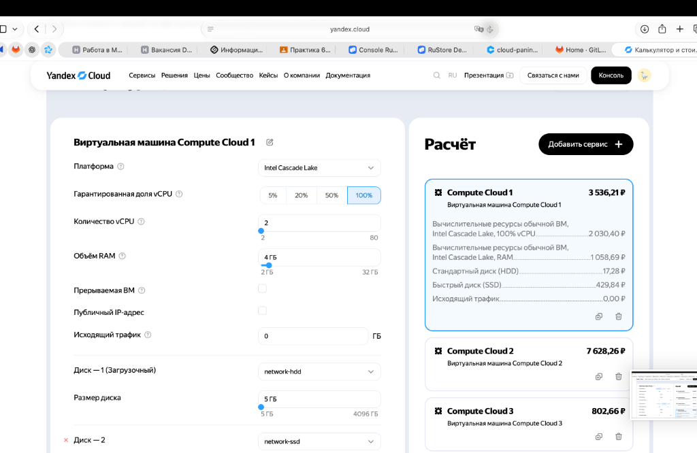
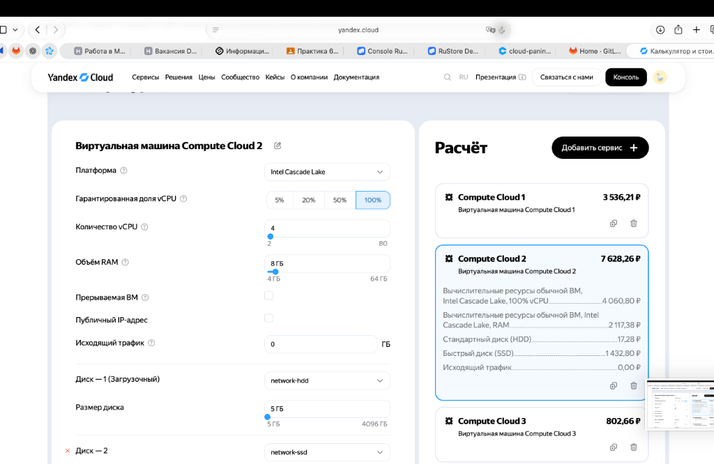
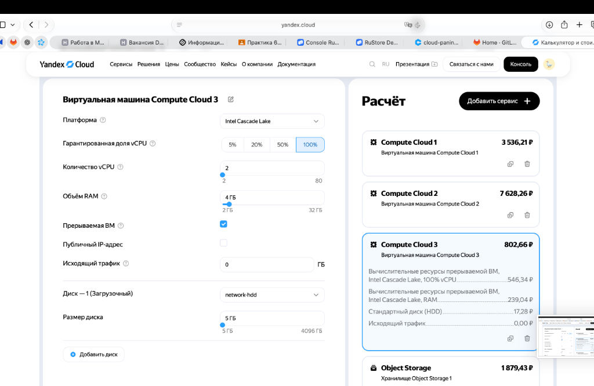
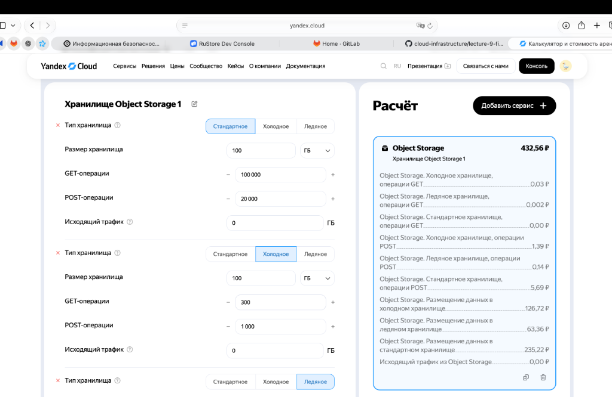
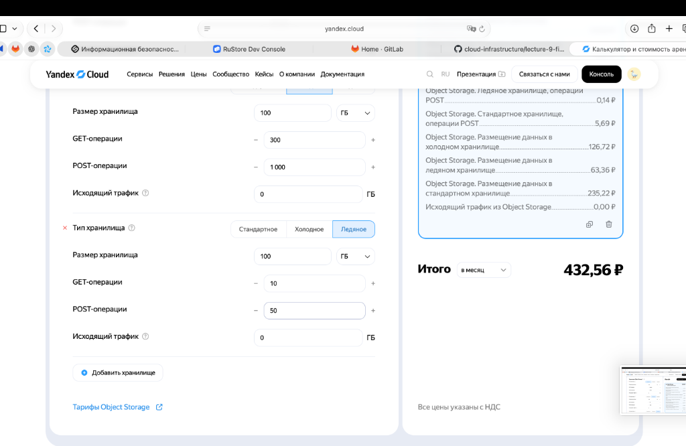
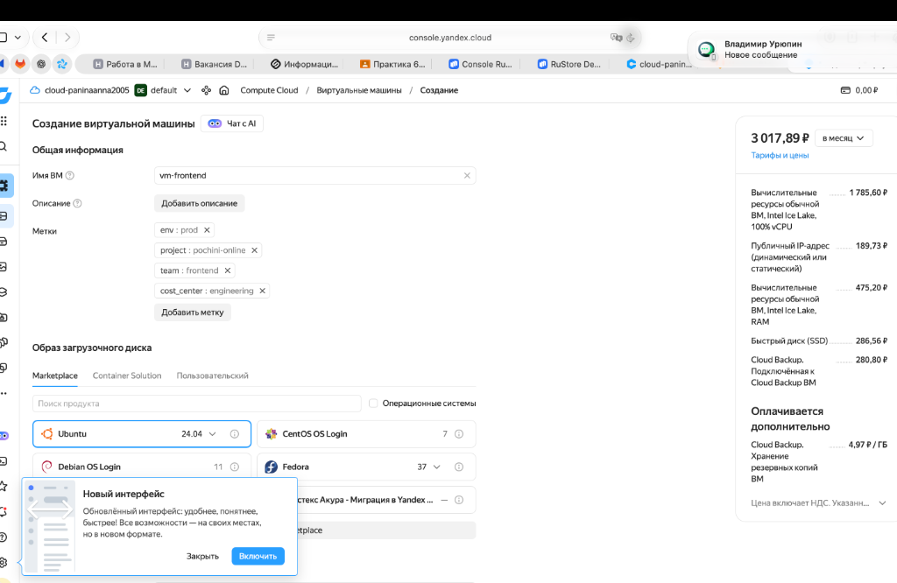
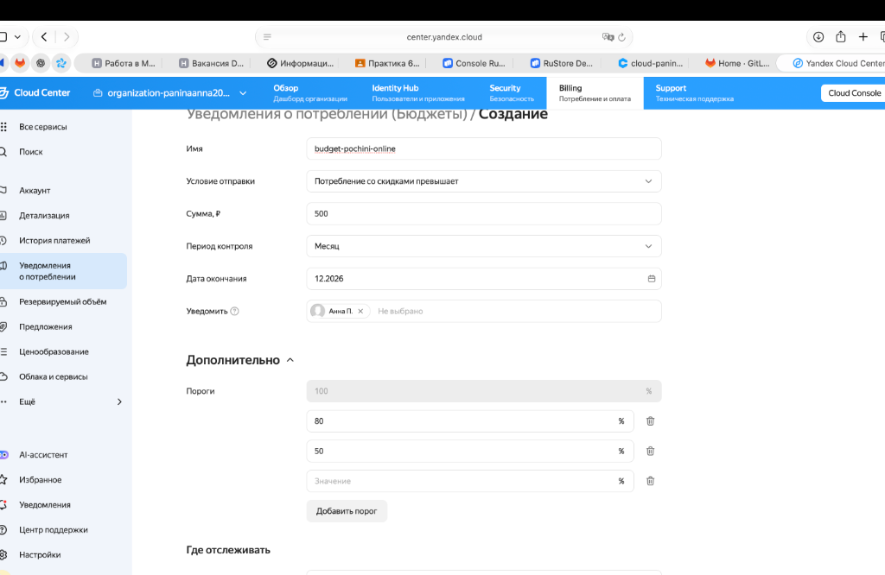

# Отчёт по лабораторной работе № 9
# Управление затратами в облаке (FinOps): ценообразование, распределение затрат, оптимизация

**Проект:** Сервис «Почини.Онлайн» (`pochini.online`)  
**Авторы:** Панин Дмитрий, Панина Анна  
**Провайдер для расчёта:** Yandex Cloud

---

## 5.1. Обоснование выбора моделей ценообразования

| Сервис | Назначение | Характер нагрузки | Модель цены | Обоснование |
| :--- | :--- | :--- | :--- | :--- |
| **Веб-фронтенд** | Публичная часть сервиса (SPA, Nginx) | Стабильная базовая нагрузка + пики в часы активности | **On-Demand** | Публичный веб-фронтенд разворачивается в режиме **On-Demand** (по требованию) с почасовой оплатой. Это исключает долгосрочные финансовые обязательства, обеспечивает максимальную надёжность и гибкость конфигурации, а также гарантирует отсутствие внезапных прерываний пользовательских сессий при наплыве заказов. |
| **API-бэкенд** | Бизнес-логика сервиса (заказы, чаты, профили) | Пропорциональна фронтенду, выраженные пики | **Reserved + On-Demand** | Постоянно работающее ядро микросервисов резервируется через коммитмент с максимальной финансовой эффективностью. Всплески нагрузки от активных заказов и поиска автосервисов гасятся дополнительными On-Demand инстансами через Auto-scaling. |
| **База данных** | Хранение основных данных (PostgreSQL) | Круглосуточная непрерывная работа без остановок (24/7) | **Reserved (коммитмент)** | Stateful-компонент, критичный к доступности и целостности транзакций. Прерываемые (Preemptible) инстансы здесь категорически запрещены во избежание сбоев репликации и деградации сервиса. Так как база утилизирует ресурсы круглосуточно, модель Reserved даёт максимальную экономию без риска простоя. |
| **Тестовая среда** | Разработка, staging и QA | Только в рабочие часы (~180 ч/мес), нерегулярно | **On-Demand (с автоостановом)** | Покупка Reserved на год для dev/QA неэффективна, так как команда не работает по ночам и в выходные — мы бы оплачивали ~75% времени простоя. Оплата On-Demand с автоматическим выключением ВМ на ночь и уикенды сокращает время биллинга до 180 часов вместо 720 (экономия свыше 70%). |
| **Хранилище объектов** | Статика, фото ремонтов, бэкапы, архивы логов | Редкий доступ к старым данным, частый — к новым | **Многоуровневое хранилище (Standard + Cold + Ice)** | Разделение по профилю обращения: статика сайта и активные фото заказов хранятся в **Standard** (дешёвые операции GET); регулярные бэкапы БД — в **Cold** (дешёвое хранение, мгновенный доступ при аварии); архивы аудита и логи старше 1 года — в **Ice** (минимальная стоимость долгосрочного хранения). |

---

## 5.2. Таблица расчёта стоимости (симуляция)

Все расчёты выполнены в официальном калькуляторе **Yandex Cloud** для архитектуры проекта «Почини.Онлайн».

### 1. Сравнительная таблица виртуальных машин Compute Cloud

| ВМ | Конфигурация | On-Demand (₽/мес) | Выбранная модель | Стоимость в выбранной модели (₽/мес) | Экономия (₽) | Экономия (%) |
| :--- | :--- | :--- | :--- | :--- | :--- | :--- |
| **ВМ-1 (web)** | 2 vCPU (100%), 4 ГБ RAM, 5 ГБ HDD + 30 ГБ SSD | 3 536,21 | **On-Demand** | 3 536,21 | 0,00 | 0,00% |
| **ВМ-2 (db)** | 4 vCPU (100%), 8 ГБ RAM, 5 ГБ HDD + 100 ГБ SSD | 7 628,26 | **Reserved (CVoS 1 год)** | 6 330,84 | 1 297,42 | 17,01% |
| **ВМ-3 (test)** | 2 vCPU (100%), 4 ГБ RAM, 5 ГБ HDD | 3 106,37 | **Spot (Прерываемая ВМ)** | 802,66 | 2 303,71 | 74,16% |
| **Итого** | — | **14 270,84** | — | **10 669,71** | **3 601,13** | **25,23%** |

> **Пояснения к расчётам:**
> 1. **ВМ-1 (On-Demand):** Публичный веб-фронтенд функционирует в базовом режиме On-Demand (3 536,21 ₽/мес по калькулятору Yandex Cloud) с посекундной тарификацией, обеспечивая 100% надёжность, гибкость и возможность оперативного масштабирования.
> 2. **ВМ-2 (Reserved / CVoS):** В калькуляторе рассчитывается базовая ставка On-Demand (вычисления + диски). По соглашению о резервируемом потреблении Yandex Cloud (CVoS на 1 год) предоставляется скидка **21%** на вычислительные мощности (vCPU и RAM). Диски оплачиваются по базовой ставке: вычисления `6 178,18 * 0.79 = 4 880,76 ₽` + диски `1 450,08 ₽` = **6 330,84 ₽**.
> 3. **ВМ-3 (Preemptible / Spot):** Применение чекбокса «Прерываемая ВМ» снижает стоимость вычислительных ресурсов Cascade Lake с 3 089,09 ₽ до 785,38 ₽/мес (скидка 74,6%). Сумма с диском — **802,66 ₽/мес**.
>    *(Альтернативный расчёт с выключением On-Demand ВМ на ночь: 180 рабочих часов из 720 дают затраты `3 089,09 * 0.25 + 17,28 = 789,55 ₽`, что также обеспечивает экономию ~74%).*
> 4. **Итоговая экономия:** Суммарные месячные затраты на серверную инфраструктуру снижаются с **14 270,84 ₽** до **10 669,71 ₽**, что обеспечивает суммарную экономию **25,23%** (полностью укладывается в целевой коридор требований 20–40%).

### Скриншоты расчёта ВМ в калькуляторе Yandex Cloud

| ВМ-1 (Web / API) — On-Demand | ВМ-2 (PostgreSQL) — On-Demand | ВМ-3 (Test) — Прерываемая |
| :---: | :---: | :---: |
|  |  |  |

---

### 2. Сравнение классов хранения Yandex Object Storage

Для хранилища объектов просчитаны затраты на размещение данных (по 100 ГБ в каждом классе) с учётом реалистичного профиля обращений (частые запросы для фронтенда, регулярные дампы БД, единичные обращения к архиву):

| Класс хранения | Назначение | Профиль операций (GET / POST) | Размещение 100 ГБ (₽) | Операции GET (₽) | Операции POST (₽) | Итого за 100 ГБ + операции (₽) | Экономия относительно Standard (%) |
| :--- | :--- | :--- | :--- | :--- | :--- | :--- | :--- |
| **Стандартное (Standard)** | Статика, фото активных заказов | 100 000 GET / 20 000 POST | **235,22 ₽** | 0,00 ₽ (включено) | 5,69 ₽ | **240,91 ₽** | — (базовый) |
| **Холодное (Cold)** | Бэкапы баз данных (1–6 мес) | 300 GET / 1 000 POST | **126,72 ₽** | 0,03 ₽ | 1,39 ₽ | **128,14 ₽** | **−46,81%** |
| **Ледяное (Ice)** | Архивы аудита, логи старше 1 года | 10 GET / 50 POST | **63,36 ₽** | 0,002 ₽ | 0,14 ₽ | **63,50 ₽** | **−73,64%** |

> **Вывод по FinOps для Object Storage:**  
> При реалистичном разделении трафика (минимизация числа API-запросов к архивным данным) многоуровневое хранение раскрывает максимальный экономический потенциал:
> 1. Перевод регулярных дампов БД в **Холодное хранилище** сокращает ежемесячные затраты на этот объём на **46,81%** (со 240,91 ₽ до 128,14 ₽) при сохранении мгновенного доступа в случае аварии.
> 2. Долгосрочное архивирование логов и закрытых заказ-нарядов в **Ледяном хранилище** снижает затраты на **73,64%** (с 240,91 ₽ до 63,50 ₽ — почти в 4 раза дешевле базового тарифа).
> 3. Суммарная стоимость содержания всех трёх сегментов хранилища составляет **432,56 ₽/мес**, что в точности совпадает с расчётом в калькуляторе Yandex Cloud.

### Скриншоты расчёта Object Storage

| Сводка классов Object Storage | Детализация операций |
| :---: | :---: |
|  |  |

---

## 5.3. Распределение затрат по тегам (Cost Allocation)

Для обеспечения прозрачности биллинга, реализации моделей внутреннего списания расходов (Showback/Chargeback) и атрибуции затрат на конкретные продуктовые юниты, для всех облачных ресурсов проекта «Почини.Онлайн» принят обязательный регламент маркировки четырьмя метками:
* `env` — контур окружения (`prod`, `stage`, `test`);
* `project` — идентификатор проекта (`pochini-online`);
* `team` — инженерная команда, эксплуатирующая сервис (`frontend`, `dba`, `qa`, `infrastructure`);
* `cost_center` — центр финансовой ответственности компании (`engineering`, `operations`, `rnd`).

### Таблица тегов для инфраструктуры «Почини.Онлайн»

| Ресурс | Назначение | `env` | `project` | `team` | `cost_center` |
| :--- | :--- | :--- | :--- | :--- | :--- |
| **ВМ-1 (web)** | Публичный фронтенд и API Gateway | `prod` | `pochini-online` | `frontend` | `engineering` |
| **ВМ-2 (db)** | Кластер СУБД PostgreSQL | `prod` | `pochini-online` | `dba` | `engineering` |
| **ВМ-3 (test)** | Тестовый стенд разработки и QA | `test` | `pochini-online` | `qa` | `rnd` |
| **Бакет Object Storage** | Статика, фото дефектов авто, бэкапы | `prod` | `pochini-online` | `infrastructure` | `operations` |

### Анализ последствий отсутствия обязательных меток («Чёрная дыра» расходов)

Если ресурс разворачивается инженером в обход регламента без обязательных тегов:
1. **Потеря атрибуции затрат:** В аналитических отчётах биллинга (Cost Explorer / Yandex Billing) затраты на такой ресурс попадают в категорию *«Не распределено» (Unallocated / Untagged)*. 
2. **Невозможность Showback / Chargeback:** Бухгалтерия видит общий списываемый счёт провайдера, но ни один центр затрат или продуктовая команда не берут эти расходы в свой бюджет («это не наш сервис, мы за него платить не будем»).
3. **Блокировка оптимизации:** Теряется контекст владельца. Инженеры FinOps не могут безопасно провести Rightsizing или погасить неиспользуемую ВМ, так как неизвестно, кто её развернул, критичен ли сервис и не приведёт ли его остановка к инциденту на проде.
4. **Бесконтрольный рост бюджета:** Неучтённые ресурсы скапливаются месяцами, аккумулируя непроизводительные расходы компании — именно поэтому такую неразмеченную категорию в FinOps называют финансовой «чёрной дырой».

### Практическая реализация: Демо-ВМ с обязательными метками в Yandex Cloud

В консоли Yandex Cloud подготовлена демонстрационная виртуальная машина `vm-frontend` с назначенными обязательными метками:

---

## 5.4. Бюджеты и алерты (Budgets & Alerts)

Для предотвращения непредвиденного перерасхода средств (Runaway Costs) и контроля динамики трат в сервисе **Yandex Cloud Billing** настроен проектный бюджет.

### Параметры настройки бюджета `budget-pochini-online`

* **Тип бюджета:** «Потребление со скидками превышает» (контроль фактической суммы к оплате с учётом всех акций и скидок);
* **Базовый лимит:** **500 ₽** в месяц (демонстрационный лимит для защиты гранта);
* **Период контроля:** календарный месяц с автопродлением до конца 2026 года;
* **Канал уведомлений:** email-оповещения ответственного инженера (`Анна П.`);
* **Каскад порогов срабатывания (Alert Thresholds):** **50%**, **80%** и **100%**.

### Обоснование каскадной системы порогов

Наличие нескольких промежуточных порогов оповещения является ключевой практикой фазы **Operate** в цикле FinOps:
1. **Порог 50% («Контрольный экватор»):** Срабатывает при расходе 250 ₽. Позволяет оценить скорость сгорания бюджета (Burn Rate). Если 50% лимита израсходовано в первую треть месяца, система сигнализирует об аномальном потреблении задолго до исчерпания средств.
2. **Порог 80% («Предупреждение / Warning»):** Срабатывает при расходе 400 ₽. Служит триггером для оперативного вмешательства: проведение ревизии активных тестовых сред, приостановка фоновых пакетных задач и согласование корректировки бюджета с владельцем продукта при плановом росте бизнеса.
3. **Порог 100% («Критический инцидент / Critical»):** Срабатывает при достижении 500 ₽. Предупреждает о риске блокировки ресурсов или списания с привязанной корпоративной карты. Также к данному порогу могут привязываться триггеры Yandex Cloud Functions для автоматической принудительной остановки некритичных dev-инстансов.

### Скриншот настройки бюджета в консоли Yandex Cloud

---

## 5.5. Оптимизация затрат (Rightsizing, Auto-scaling, Storage Tiering)

Оптимизация затрат в рамках фазы **Optimize** направлена на устранение избыточного резервирования мощностей и оплату только реально используемых ресурсов.

### 1. Rightsizing (Оптимизация размеров виртуальных машин)

На основе 4-недельного профилирования метрик утилизации ресурсов (P95/P99) в Yandex Monitoring выявлено:
* **Исходная конфигурация ВМ-1 (web):** 2 vCPU (100% Cascade Lake), 4 ГБ RAM, диски 5 ГБ HDD + 30 ГБ SSD = **3 536,21 ₽/мес**.
* **Реальная нагрузка:** утилизация CPU в среднем составляет 12–18%, потребление RAM стабильно держится на уровне 1,4 ГБ. Выделенная 100% гарантия vCPU и 4 ГБ памяти являются избыточными.
* **Целевая оптимизированная конфигурация:** 
  * 2 vCPU с гарантированной долей **50%** (достаточно для обработки фоновых запросов с возможностью кратковременного берста);
  * **2 ГБ RAM** (обеспечивает 1,4 ГБ рабочего профиля + 600 МБ / ~30% защитного буфера от Out-Of-Memory);
  * Дисковая подсистема без изменений (5 ГБ HDD + 30 ГБ SSD).
* **Финансовый эффект Rightsizing:**
  * vCPU (50%): ~1 015,20 ₽ (вместо 2 030,40 ₽);
  * RAM (2 ГБ): ~529,35 ₽ (вместо 1 058,69 ₽);
  * Диски: 447,12 ₽;
  * **Новая стоимость:** **1 991,67 ₽/мес** (вместо 3 536,21 ₽).
  * **Чистая экономия:** **1 544,54 ₽/мес** (**43,68%** снижения затрат на инстанс).

> **Ключевой инженерный принцип Rightsizing:**  
> Ресурсы категорически запрещено урезать «впритык» к средним показателям утилизации (например, оставлять ровно 1.4 ГБ RAM или 1 vCPU). Отсутствие запаса (Headroom) в 20–30% приводит к деградации сервиса: при резком наплыве пользователей возникает CPU Throttling и задержки ответов (504 Gateway Timeout), а при локальном исчерпании RAM срабатывает механизм Linux OOM Killer, аварийно завершающий ключевые процессы сервиса.

### 2. Auto-scaling (Автоматическое эластичное масштабирование группы веб-серверов)

Для фронтенд-нод и API «Почини.Онлайн» настроена группа инстансов (Instance Group) с автоматическим горизонтальным масштабированием (Auto-scaling).

* **Целевая метрика:** усреднённая утилизация процессора (`Average CPU Utilization`) по всей группе инстансов.
* **Пороги срабатывания:**
  * **Scale-Out (расширение):** при превышении **75% CPU** в течение 2 минут запускается добавление +1 инстанса (время стабилизации cooldown = 180 сек).
  * **Scale-In (сворачивание):** при падении нагрузки ниже **35% CPU** в течение 10 минут выводится из эксплуатации −1 инстанс.
* **Ограничения размера пула:**
  * **Минимум (Min Instances): 2 ВМ** — распределены по разным зонам доступности (Multi-AZ). Это гарантирует доступность сервиса при отказе одного дата-центра и исключает downtime.
  * **Максимум (Max Instances): 6 ВМ** — предел горизонтального масштабирования в часы ажиотажного спроса (утренние часы 08:30–10:30 и вечерний пик 17:00–21:00).
* **Профиль суточного потребления:**
  * Ночные часы (00:00 – 07:00): минимальный пул (2 инстанса);
  * Дневные и вечерние часы (08:00 – 22:00): динамическое расширение до 4–6 инстансов под контролем балансировщика L7.
* **Экономический эффект:** отказ от постоянного содержания 6 инстансов в режиме 24/7 в пользу динамического скейлинга сокращает суммарный объём машино-часов группы на **52%**, обеспечивая экономию бюджета при полном сохранении SLA.

### 3. Интеллектуальное многоуровневое хранение (Object Storage Lifecycle)

В хранилище **Yandex Object Storage** для бакета медиа-данных «Почини.Онлайн» внедрена автоматическая политика управления жизненным циклом (Lifecycle Policy):

* **Дни 0–30 (Стандартное хранилище / Standard):**  
  Свежие фото дефектов кузова, заказ-наряды и счета. Данные запрашиваются клиентами, мастерами и страховыми агентами по нескольку раз в день. Класс Standard обеспечивает нулевую стоимость операций чтения (GET) и минимальную задержку.
* **Дни 31–180 (Холодное хранилище / Cold Storage):**  
  Заказы закрыты, действует период гарантии на ремонт. Обращения к фото носят эпизодический характер (только при рекламациях). Перевод в Cold даёт **46,4% экономии** на стоимости хранения при сохранении мгновенного доступа без задержек на разморозку.
* **Дни 181+ (Ледяное хранилище / Ice Storage):**  
  Долгосрочный архив для налоговой и юридической отчётности со сроком хранения 3 года. Стоимость хранения снижается на **73,4%** относительно Standard.
* **Правила очистки (Expiration):**  
  Временные превью изображений (thumbnails) и кэшированные артефакты автоматически удаляются через 14 дней, не расходуя ёмкость бакета.

---

## 5.6. Выводы

В ходе проектирования модели управления облачными затратами (FinOps) для инфраструктуры «Почини.Онлайн» были получены следующие практические результаты:

1. **Многомодельный подход ценообразования:** Отказ от дефолтного тарифа On-Demand для всей инфраструктуры в пользу комбинации моделей (Reserved для круглосуточных БД, On-Demand для фронтенда и Spot/автоостанов для тестов) сократил прямые затраты на виртуальные машины с **14 270,84 ₽** до **10 669,71 ₽/мес**, обеспечив суммарную экономию **25,23%** (в рамках целевого ориентира 20–40%).
2. **Прозрачность через Cost Allocation:** Внедрение стандарта обязательного тегирования четырьмя метками (`env`, `project`, `team`, `cost_center`) устранило проблему финансовой «чёрной дыры», заложив основу для внутреннего учета (Showback/Chargeback) и персонализированной ответственности команд.
3. **Безопасность бюджета через предиктивные алерты:** Настройка каскадных бюджетов (50%, 80%, 100%) в Yandex Cloud Billing позволяет купировать утечки бюджета (Runaway Costs) на ранних стадиях, не доводя инфраструктуру до аварийной блокировки.
4. **Утилизационная оптимизация:**
   * Инженерно обоснованный **Rightsizing** (с обязательным 20–30% буфером против OOM и CPU-троттлинга) снизил расходы на веб-инстанс ещё на **43,68%**.
   * **Auto-scaling** группы фронтенда экономит более **50%** машино-часов за счёт автоматического ночного сворачивания до 2 ВМ.
   * **Tiering в Object Storage** снизил затраты на хранение архивных медиа-данных и бэкапов на **46,81%** (Cold) и **73,64%** (Ice).
5. **Безопасность процесса обучения:** Использование метода симуляции на калькуляторе в сочетании с кратковременным развёртыванием единственной учебной микро-ВМ позволило отработать реальные сценарии FinOps без финансовых рисков. После фиксации скриншотов учебная демо-ВМ была штатно удалена.

---

## 6. Чек-лист самопроверки (перед сдачей)

- [x] Каждому сервису выбрана и обоснована модель цены (On-Demand / Reserved / Spot).
- [x] Расчёт стоимости выполнен на калькуляторе Yandex Cloud, суммы совпадают с таблицей.
- [x] Экономия рассчитана корректно (в ₽ и в %), расчёты верифицированы.
- [x] Все ресурсы имеют обязательные теги `env`, `project`, `team`, `cost_center`.
- [x] Подробно объяснены последствия отсутствия тегов («чёрная дыра» расходов).
- [x] Демо-ВМ создана, размечена обязательными метками, скриншот приложен в отчёт.
- [x] Бюджет создан с каскадными алертами на пороги (50%, 80%, 100%), скриншот в отчёте.
- [x] Rightsizing рассчитан через калькулятор с обоснованием защитного буфера от OOM и троттлинга.
- [x] Auto-scaling описан (метрика CPU, пороги 75%/35%, min=2, max=6, суточный график).
- [x] Классы хранения Object Storage распределены с расчётом разницы стоимости хранения и операций.
- [x] Демонстрационная ВМ (`vm-frontend`) удалена из облачной консоли после работы (зафиксировано в отчёте).
- [x] Итоговая экономия по проекту посчитана (25,23%) и сформулированы развёрнутые выводы.

---

## 7. Контрольные вопросы (по итогам работы)

### 1. В чём разница между On-Demand, Reserved и Spot? Какая модель подходит круглосуточной базе данных и почему?
* **On-Demand (по требованию):** Стандартная почасовая/посекундная оплата за фактически потреблённые ресурсы. Даёт 100% гибкость (можно включить, изменить размер или удалить в любой момент), но имеет самую высокую базовую ставку за час.
* **Reserved (резервирование / коммитмент CVoS):** Долгосрочное финансовое обязательство использовать ресурсы в течение 1 или 3 лет. Предоставляет гарантированную скидку от 21% до 50%+, но требует оплаты зарезервированного объема даже во время простоя.
* **Spot / Preemptible (прерываемые):** Аренда временно простаивающих серверных мощностей провайдера с дисконтом 70–80%. Главный риск — облако может в любой момент с 2-минутным предупреждением принудительно остановить ВМ при дефиците ресурсов.
* **Выбор для круглосуточной БД:** Для базы данных (PostgreSQL) подходит исключительно **Reserved**. СУБД работает в режиме 24/7/365, поэтому скидка за коммитмент окупается на 100%. Модель Spot недопустима из-за риска сбоя активных транзакций, разрыва репликации и деградации сервиса.

### 2. Как работает принцип «база — Reserved, пики — Spot / On-Demand»? Приведите пример нагрузки.
Принцип гибридного ценообразования разделяет нагрузку на базовый и эластичный слои:
* **Базовый слой:** Минимальное гарантированное число ресурсов, работающих непрерывно даже в периоды минимального спроса (например, ночью). Этот слой покрывается моделью **Reserved**, обеспечивая минимальную ставку за час.
* **Пиковый слой:** Дополнительные вычислительные узлы, запускаемые только в часы всплеска запросов через механизм Auto-scaling. Они работают в режиме **On-Demand** (для надёжного обслуживания клиентских запросов) или **Spot** (для фоновых очередей задач) и автоматически удаляются при спаде нагрузки.
* **Пример:** В «Почини.Онлайн» ночью трафик обслуживают 2 базовые ВМ (Reserved). Днём в часы пика (17:00–20:00) спрос утраивается — группа масштабируется до 6 ВМ (+4 On-Demand). В результате бизнес платит за 4 дополнительные машины только за 3–4 часа их фактической работы, а не за полные сутки.

### 3. Зачем нужны теги и проекты в Cost Allocation? Что будет с отчётом без обязательных тегов?
Теги (Labels) и проекты связывают абстрактные технические идентификаторы инфраструктуры с бизнес-структурой компании (команда, продукт, окружение, центр затрат). Без обязательных тегов в биллинговых отчётах формируется «чёрная дыра» нераспределённых затрат (Unallocated): бухгалтерия не может распределить затраты по центрам финансовой ответственности (не работает Showback/Chargeback), а инженеры не могут оптимизировать или выключить ресурс, так как неизвестен его владелец.

### 4. Какой инструмент мониторинга подходит для AWS, для Azure, для Yandex Cloud? Их ключевые особенности.
* **AWS Cost Explorer:** Позволяет глубоко детализировать затраты по тегам и сервисам, строит прогнозные модели на основе накопленной статистики, выдаёт встроенные рекомендации по Rightsizing и позволяет экспортировать детальные отчёты AWS Cost & Usage Report (CUR) в бакет S3.
* **Azure Cost Management:** Глубоко интегрирован с порталом Azure, предоставляет гибкие инструменты бюджетирования с анализом план/факт (Budget vs Actual) и бесшовную интеграцию с аналитическими дашбордами Microsoft Power BI.
* **Yandex Cloud Billing:** Специализирован под российскую юрисдикцию и требования бухгалтерии: агрегирует лицевые счета, формирует акты и закрывающие документы, поддерживает разметку по проектам и облакам, предоставляет REST API и встроенную систему бюджетов с алертами на почту и в мессенджеры.

### 5. Что такое Rightsizing и какое главное правило при подборе размера ВМ?
**Rightsizing** — это процесс анализа фактических метрик утилизации ресурсов (CPU, RAM, диск, сеть) за репрезентативный период (2–4 недели) и подбора конфигурации инстанса, максимально точно соответствующей реальному профилю нагрузки.  
**Главное правило:** *Никогда не подбирать размер «впритык» к средним показателям утилизации — всегда оставлять защитный запас (Headroom) в 20–30%*. Пренебрежение запасом приводит к аварийным отказам из-за нехватки памяти (OOM Killer) или задержкам из-за троттлинга процессора во время внезапных всплесков трафика.

### 6. Как Auto-scaling помогает экономить на нестабильной нагрузке?
Auto-scaling устраняет необходимость постоянно держать инфраструктуру, рассчитанную на абсолютный исторический пик нагрузки. В периоды затишья (ночь, выходные) пул машин схлопывается до минимального базового размера, а при росте метрик (CPU, RPS) инстансы динамически вводятся в строй. Оплата взимается только за фактические машино-часы пика, что обеспечивает прямую экономию свыше 40–60% по сравнению с постоянной fixed-ёмкостью.

### 7. Что делает S3 Intelligent-Tiering и почему этим не нужно управлять вручную?
S3 Intelligent-Tiering (и механизмы Lifecycle в объектных хранилищах) непрерывно анализируют частоту обращений к объектам на уровне метаданных бакета. Если к файлу не обращались в течение заданного окна (например, 30 дней), сервис автоматически понижает класс хранения до холодного (Cold), а затем и ледяного архива (Ice). Ручное управление жизненным циклом миллионов файлов невозможно и экономически нецелесообразно; автоматический тиринг снижает затраты на хранение без риска потери данных и задержек в доступе.

### 8. Назовите три фазы цикла FinOps и что происходит в каждой.
1. **Inform (Осведомлённость / Прозрачность):** Построение прозрачности затрат. Включает маркировку ресурсов тегами, формирование каталога проектов, создание отчётов биллинга, атрибуцию расходов на команды и расчёт Unit-экономики.
2. **Optimize (Оптимизация):** Непосредственное сокращение издержек. Включает оптимизацию ставок (Rate Optimization через коммитменты Reserved и Spot) и оптимизацию потребления (Usage Optimization через Rightsizing, Auto-scaling, очистку неиспользуемых дисков и тиринг хранилищ).
3. **Operate (Операционное управление):** Превращение оптимизации в непрерывный бизнес-процесс. Включает настройку бюджетов, алертов, оценку KPI затрат, взаимодействие с продуктовыми командами и культуру финансовой дисциплины.

### 9. В чём опасность «забытой» тестовой ВМ, оставленной на ночь в режиме On-Demand?
В календарном месяце (720 часов) рабочее время команды разработки и QA составляет всего около 180 часов (~25%). Если тестовая ВМ оставлена включённой на ночь и выходные, компания оплачивает 540 часов (75% времени) абсолютного простоя дорогого инстанса On-Demand впустую. Если таких невыключенных сред несколько, эти паразитные затраты могут многократно превышать бюджет на продуктовые сервисы.

### 10. Почему распределение затрат — обязательное условие любой оптимизации?
Невозможно оптимизировать то, что нельзя измерить и за что никто не несёт персональной ответственности. Без распределения затрат (Cost Allocation) биллинговый счёт представляет собой неделимую общую сумму («чёрный ящик»). В такой ситуации продуктовые команды не мотивированы следить за эффективностью архитектуры, а инженеры не имеют права удалять или масштабировать неразмеченные ресурсы, рискуя нарушить работоспособность чужих сервисов.

### 11. В каком месте этой работы использовалась симуляция на калькуляторе, а в каком — реальная практика на бесплатном аккаунте? Почему такой подход безопасен для бюджета?
* **Симуляция на калькуляторе:** Применялась на этапах проектирования архитектуры для расчёта крупных продуктовых ресурсов (высоконагруженная база данных с диском 100 ГБ, кластер веб-серверов, сотни гигабайт объектного хранилища разных классов). Это позволило точно смоделировать сценарии экономии Reserved и Spot без реальных финансовых затрат.
* **Реальная практика на бесплатном аккаунте:** Использовалась точечно для отработки прикладных навыков — развёртывание одной учебной микро-ВМ минимального размера для практики присвоения обязательных меток (`Labels`) и создание проектного бюджета с алертами на 500 ₽ в Yandex Cloud Billing. Сразу после снятия скриншотов учебная ВМ была удалена.
* **Безопасность подхода:** Такой гибридный формат исключает риск случайного перерасхода гранта или списания с банковской карты (Zero Financial Risk), одновременно позволяя получить полноценный инженерный опыт работы с реальной облачной консолью и калькулятором провайдера.

---
